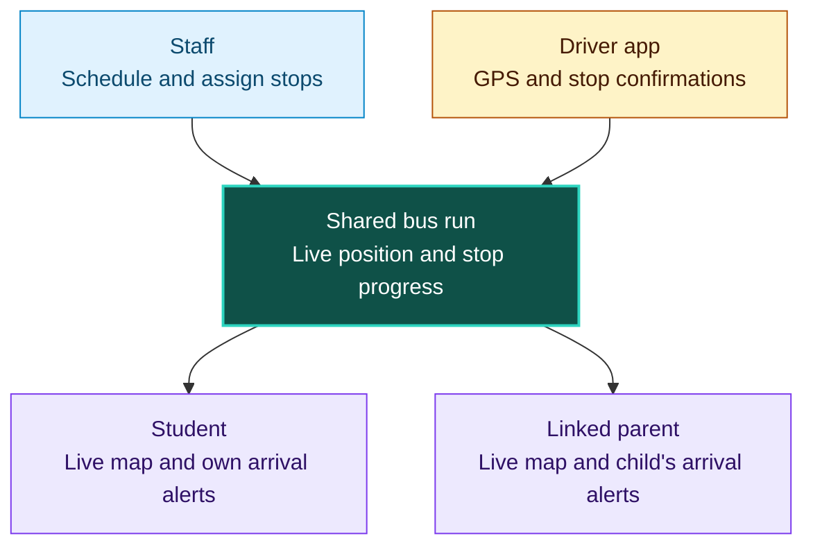
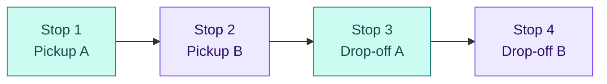
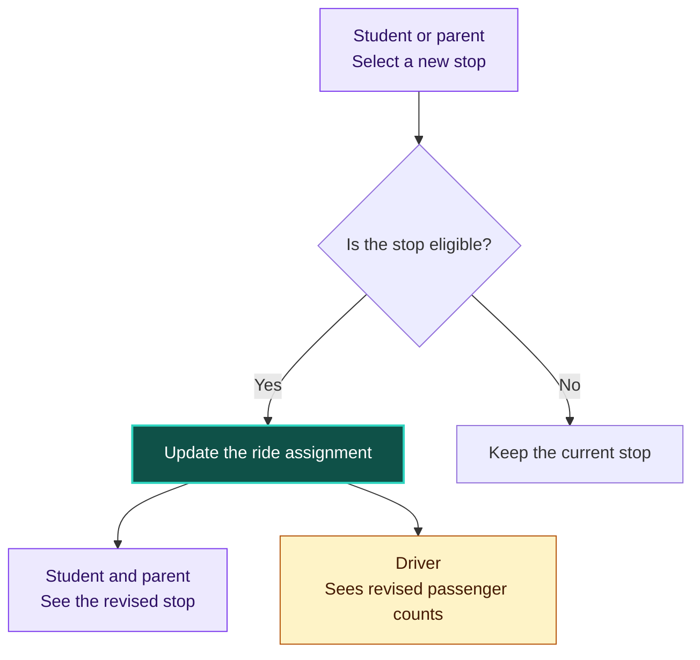

# Basi Shared Bus Release

Basi is a bus transport app in Saudi Arabia. This release connects individual subscription rides to a shared bus run. The driver reports arrivals from the route map, and the student and linked parent follow the same bus. Each rider keeps their own pickup, drop-off, and arrival alerts.

[See how the apps work together](#how-the-apps-work-together) · [Follow a four-stop trip](#a-four-stop-trip) · [See why the changes matter](#why-the-changes-matter)

## How the apps work together

Staff assign scheduled rides to an ordered route. The Driver app sends location updates, and the driver confirms each stop in order. The shared run keeps the bus position and stop progress in sync across Driver, Student, and Parent.

## Why the changes matter

| Area | What changed | Why it matters |
| --- | --- | --- |
| Shared tracking | Individual rides share one run. The apps reload trip progress after reconnecting. | Families can see where their bus is and which stop comes next. |
| Arrivals | The driver confirms each stop on the map. Basi creates an alert for each affected ride. | Students and linked parents know when it is time to board or get off. |
| iOS alerts | Added push registration, queued delivery, and alerts that open the assigned ride. | With Apple push configured, iOS can show alerts while the Family app is closed. |
| Stop selection | A student or linked parent can change an eligible upcoming stop. The driver's stop list updates. | The driver sees how many pickups and drop-offs to expect at each stop. |
| Street directions | Both maps draw the same street route and move a bus icon with GPS. | Riders can see the streets the bus is expected to take and track its progress. |

## A four-stop trip

The driver visits these four stations in order. **Student A and Parent A** get their pickup and drop-off alerts at stops 1 and 3. **Student B and Parent B** get theirs at stops 2 and 4.

A pickup moves that student's ride to **In progress**. A drop-off completes the student's ride. The bus run closes after the driver confirms the final stop.

## How a stop change reaches the driver

The Family app lets the student or linked parent pick an eligible stop on the existing route. Pickup must come before drop-off. Once pickup is confirmed, the rider can still change to an eligible upcoming drop-off.

If Student A moves their drop-off from stop 3 to stop 4, the count falls by one at stop 3 and rises by one at stop 4. The bus still visits the stops in the scheduled order.

## More in this release

- **Startup.** Repaired the Family app imports and preserved explicit Driver settings while filling missing defaults.
- **Card checkout.** Added server-side Moyasar payment verification and retry protection before dispatch. Riders can resume checkout after a 3-D Secure challenge.
- **Browser pairing.** Updated the tool to use the current scheduled-ride APIs for Driver and Family.

## Release documentation

- See how the project evolved and follow the ride from scheduling to the final stop. [Change and Trip Flow](CHANGE_FLOW.md)
- Review the release changes and their configuration settings. [Release Changes](RELEASE_CHANGES.md)
- See what changed in each screen and module and how the apps, backend, and providers work together. [Implementation Guide](IMPLEMENTATION.md)
- Set up the backend and both apps, then try a four-stop ride as Driver, Student, and Parent. [Run Guide](RUN_GUIDE.md)
- See what each completed check covered and its result. [Testing](TESTING.md)
